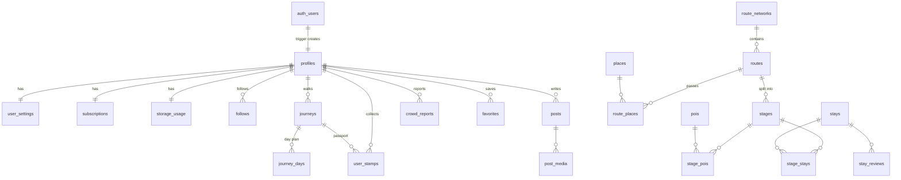
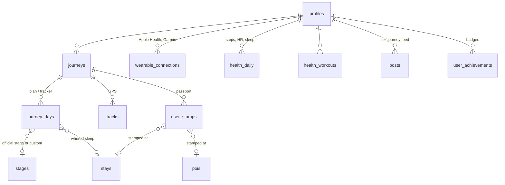
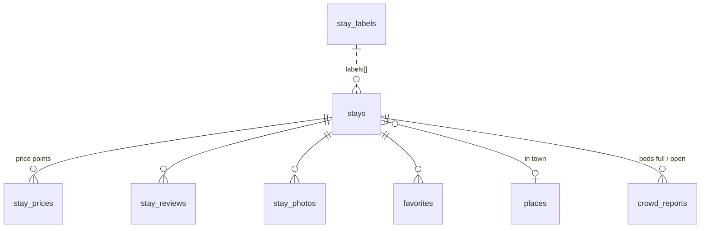
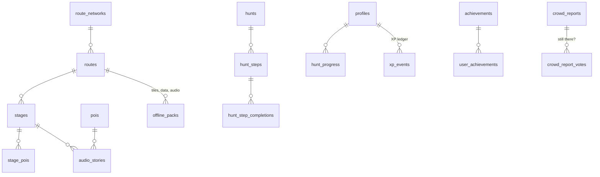
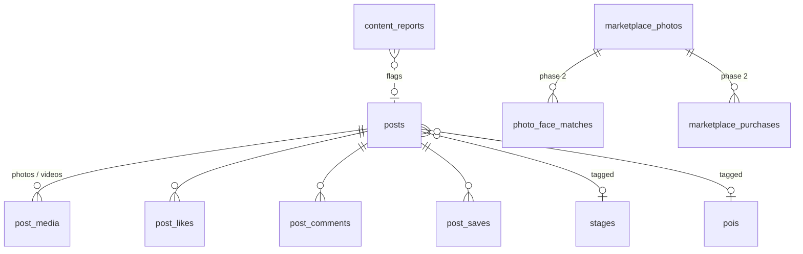
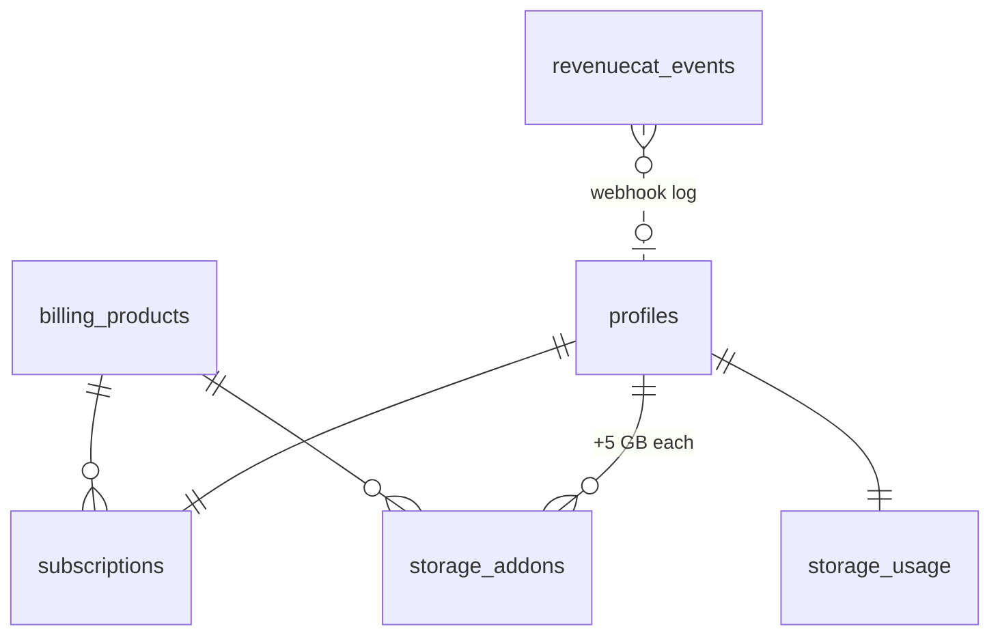

# CaminoPlus database (Supabase)

Postgres schema, row level security, storage buckets and RPCs for the CaminoPlus app.
53 tables in `public` (plus 2 server-only tables in `private`), split by app area.

```
supabase/
  config.toml              CLI config: email + Google auth, redirect URLs
  migrations/              apply in order (supabase db push)
    ..._foundation.sql          extensions, private schema, shared helpers
    ..._profiles_auth.sql       profiles (auto-created on sign-up), follows, blocks, settings, devices
    ..._routes_maps.sql         networks, routes, places, stages, POIs, audio, offline packs
    ..._stays.sql               stays and cafes, labels, prices, photos, reviews, favourites
    ..._gamification_crowd.sql  XP ledger, achievements, scavenger hunts, crowd reports
    ..._me_journey.sql          journeys (plan/tracker), GPS tracks, passport stamps, health
    ..._social.sql              posts (journal, photo, reel, story), media, likes, comments, reports
    ..._billing_storage.sql     RevenueCat subscription state, storage add-ons, quota, buckets
    ..._marketplace_phase2.sql  face-match photo marketplace (tables only, feature off)
    ..._rpc.sql                 search_stays, nearby_pois, complete_hunt_step, get_my_storage, ...
  seed.sql                 reference data + a small Camino Frances sample
  dev/validate.sh          applies everything to a throwaway local Postgres and runs dev/rls_smoke.sql
```

## Auth: email and Google

Supabase Auth handles both. A trigger on `auth.users` creates `profiles`, `user_settings`,
`storage_usage` and an empty `subscriptions` row for every new user, whichever way they signed up.
For Google sign-ups it copies `full_name` and `avatar_url` from the Google profile; the username
comes from the email (made unique automatically, the user can change it later).

Setup in the hosted project:

1. **Email**: Auth > Providers > Email on, "Confirm email" on. Set custom SMTP to Resend so
   confirmation and magic-link emails come from camino.plus.
2. **Google**: create OAuth client IDs in Google Cloud (Web, iOS, Android). Put the Web client ID
   and secret in Auth > Providers > Google, and add the iOS and Android client IDs to
   "Authorized Client IDs". The app uses native Google Sign-In and `supabase.auth.signInWithIdToken`.
   "Skip nonce check" is on because iOS Google Sign-In does not send a nonce.
3. **Redirect URLs**: `https://camino.plus/auth/callback` and `caminoplus://auth-callback`.

Local: set `SUPABASE_AUTH_EXTERNAL_GOOGLE_CLIENT_ID` and `SUPABASE_AUTH_EXTERNAL_GOOGLE_SECRET`
before `supabase start`.

## Overview



### Me tab



- **Profile** (`profiles`): Instagram-style card, counters (followers, posts, stamps, km walked), XP and level.
- **Self journey**: the user's own `posts` (any kind, including private `journal` entries).
- **Passport and stamps**: `user_stamps`. A stamp is `verified` when its GPS fix is within 300 m
  of the stay or POI. Verified stamps give 10 XP, unverified 2 XP.
- **Plan**: `journeys` (one pilgrimage attempt, start anywhere on any route) and `journey_days`.
  Marking a day `done` gives 50 XP and updates km walked. Journey `visibility` also controls who
  sees its plan, tracks and stamps.
- **Health**: `health_daily` and `health_workouts` keep only what the device provides (all metric
  columns are nullable). Owner-only access. Garmin OAuth tokens live in `private.wearable_credentials`
  as Supabase Vault references, never readable by clients.

### Stays tab



- `stays` holds both places to sleep and places to eat (`kind` = `stay` or `food`, derived from `category`).
- Imported from OpenStreetMap first (`osm_type`, `osm_id`); other sources go in `source` and `external_ids`.
- `booking_method` is the per-stay label: walk-in, email, WhatsApp, phone, website, OTA, in-app (later).
- Filters map to columns: category, `rating_avg`, `price_from`, `labels` (GIN index), distance (PostGIS),
  favourites/bookmarks (`favorites.list`). One call does it all: `rpc('search_stays', {...})`.
- Ratings, price range and favourite counts are kept up to date by triggers.

### Maps tab



- **Route-agnostic**: `route_networks` (Camino de Santiago now; Via Francigena or others later) >
  `routes` > `stages`, with `places` and `route_places` (km from start / km to destination for every town).
- **POIs**: churches, cathedrals, iconic places, fountains, pharmacies... with `has_stamp`, `mass_times`, `story`.
- **Audio stories** per stage or POI with a trigger radius for auto-play. Files are on Cloudflare R2.
- **Offline packs**: manifest of downloadable files per route or stage (`pmtiles`, `sqlite`, audio zip),
  with version, size and sha256 so the app can download in stages and update only what changed.
  CaminoPlus only (see Settings and billing).
- **Scavenger hunts**: steps verified by GPS, photo, answer or QR. Answers are in `private.hunt_step_answers`
  and checked by `rpc('complete_hunt_step')`, which is safe to replay from the offline outbox.
- **XP**: `xp_events` is an append-only ledger with one row per (reason, source), so XP can never be
  granted twice. Only server code writes XP and achievements.
- **Crowd reports**: Waze style. Each kind has a time to live (crowd level 2 h, beds full 12 h,
  hazard 24 h, closed 7 days, ...; overridable in `app_config`). A "still there" vote extends it;
  a report hides once denials outnumber confirmations by 3. Realtime is enabled on this table.
- **Weather** comes from an API through an edge function; it is not stored.

### Explore tab



- One `posts` table with `kind` = journal, photo, video, reel, story. Explore reads public, published posts;
  stories expire after 24 h.
- Visibility: `private`, `followers`, `public`. A private account shows its public posts to followers only.
  Blocks hide everything both ways.
- `content_reports` collects user flags; the moderation workflow is still an open decision.
- **Photo marketplace (phase 2)**: tables exist but nothing uses them yet. Face templates (biometric data)
  are deliberately not stored in this database; only consent records and match results are.

### Settings and billing



- `billing_products`: `plus_yearly` ($12/year, 5 GB) and `storage_5gb_yearly` ($5/year, +5 GB).
- `subscriptions` mirrors RevenueCat. Only the RevenueCat webhook edge function (service role) writes it,
  logging every event in `revenuecat_events` (event id is the primary key, so retries are harmless).
- **Free = basic app**: 0 GB cloud storage and no offline route downloads. Everything else
  (browsing routes, stays, map online, social) works. `rpc('get_my_entitlements')` tells the app
  which plan the user is on.
- Offline pack URLs (`offline_packs`) are readable only with CaminoPlus; free users see sizes via
  `rpc('offline_pack_catalog')` for the upgrade prompt. Pack files on R2 must be served through
  signed URLs from an edge function that checks the plan.
- Quota = 5 GB with an active plan (including grace period and "cancelled but not yet expired")
  + all active add-ons. Without a plan the quota is `app_config.free_storage_bytes` (0 for now).
- Uploads to the `user-media` bucket are refused once usage reaches the quota. Nothing is deleted
  automatically; the user frees space or buys more.
- `rpc('get_my_storage')` returns plan, quota, used and remaining for the Settings screen.
  `rpc('refresh_my_storage_usage')` recounts after an upload batch.

## Storage buckets

| Bucket | Access | Used for |
|---|---|---|
| `avatars` | public read, owner write | profile pictures, `<user_id>/...` |
| `user-media` | private, counts toward quota | post photos/videos, stamp photos, crowd photos, `<user_id>/...` |
| `public-media` | public read, server write | curated stay photos, covers |

A file in `user-media` can be read by its owner and by anyone who can see the post, stamp or crowd
report that points to it (the app requests signed URLs). Map tiles, offline packs and audio are on Cloudflare R2.

## Offline sync conventions

Built for 6 to 8 hours without signal:

- **Client-generated ids**: every user-writable table has a uuid `id` the app may generate on the device.
  Outbox items are sent as upserts on `id`, so sending the same item twice is harmless.
- **`client_created_at`** keeps the real time something happened offline (stamps, reports, posts);
  `created_at` and `updated_at` are server time.
- **`updated_at` is the sync cursor**: pull with `updated_at > last_sync` (minus a few seconds of overlap).
  It is set by a trigger, so device clocks cannot break it.
- **Soft deletes** (`deleted_at`) so deletions reach other devices and offline copies. Clients cannot hard
  delete synced content; likes, saves, follows and votes are hard deleted because they are only toggles.
- **Server-owned columns** (XP, counters, ratings, moderation, `verified`, report expiry) are protected
  by a guard trigger: clients can upsert whole rows but their values for these columns are ignored.
- Catalog tables (routes, stages, POIs, stays) are packaged into offline packs; tombstones stay readable
  so packs can remove deleted rows.

## Security

- RLS is on for every table in `public`; the last migration fails if any table is missing it.
- Catalog data (except offline pack URLs) is readable without login (for the camino.plus website); everything personal needs a session.
- Helper functions used by policies live in the `private` schema, which is not exposed by the API.
- Health data, settings, devices, storage usage and subscriptions are owner-only.

## Running it

Hosted project:

```bash
supabase link --project-ref <ref>
supabase db push            # applies migrations
psql "$DB_URL" -f supabase/seed.sql   # optional sample data
```

Scheduled job (Database > Cron) for cleanup and add-on expiry:

```sql
select cron.schedule('caminoplus-housekeeping', '*/15 * * * *', 'select private.housekeeping()');
```

Quick check without Docker (needs Postgres 16+ with PostGIS):

```bash
supabase/dev/validate.sh    # migrations + seed + RLS smoke test (about 50 assertions)
```

## Open decisions

- Moderation workflow for posts and comments (tables and flags are ready).
- Whether `is_premium` audio stories are gated (currently the URL is public).
- Phase 2 marketplace: legal review of face matching before any of it is switched on.
