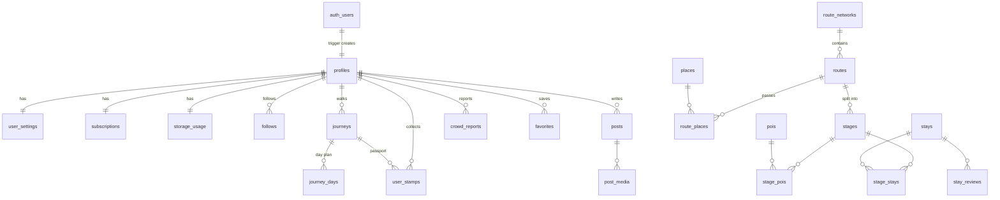
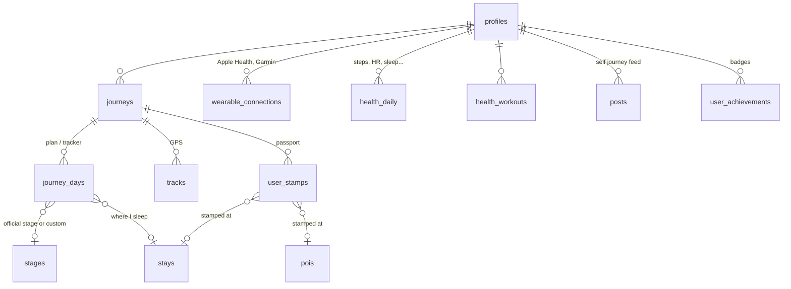
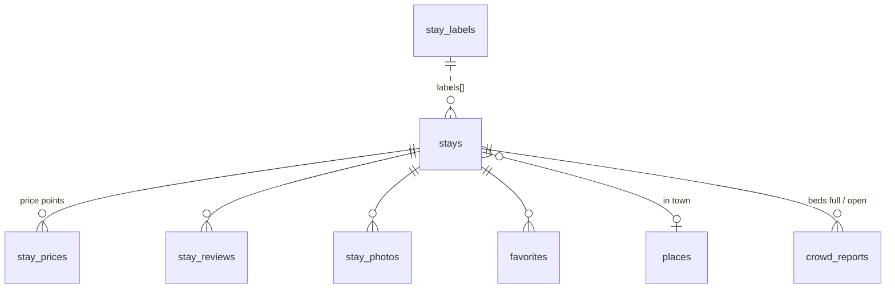
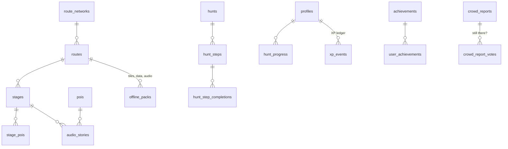
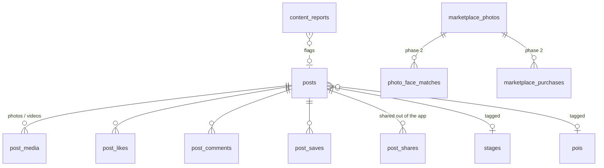
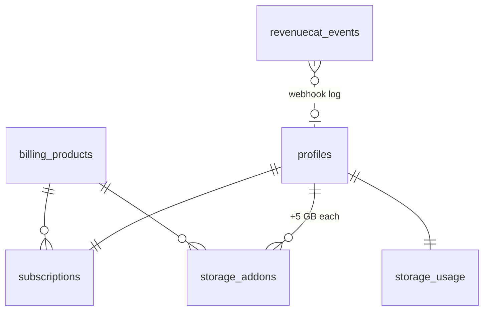
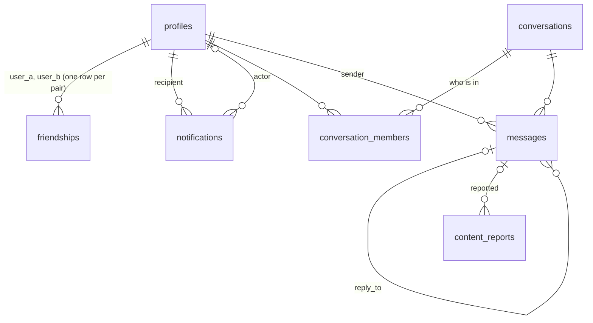

# CaminoPlus database (Supabase)

Postgres schema, row level security, storage buckets and RPCs for the CaminoPlus app.
72 tables in `public` (plus 4 server-only tables in `private`), split by app area.

```
supabase/
  config.toml              CLI config: email + Google auth, redirect URLs
  migrations/              apply in order (supabase db push)
    ..._foundation.sql          extensions, private schema, shared helpers
    ..._profiles_auth.sql       profiles (auto-created on sign-up), follows, blocks, settings, devices
    ..._routes_maps.sql         networks, routes, places, stages, POIs, audio, offline packs
    ..._stays.sql               stays and cafes, labels, prices, photos, reviews, favourites
    ..._gamification_crowd.sql  XP ledger, achievements, scavenger hunts, crowd reports
    ..._me_journey.sql          journeys (plan/tracker), GPS tracks, passport stamps, health
    ..._social.sql              posts (journal, photo, reel, story), media, likes, comments, reports
    ..._billing_storage.sql     RevenueCat subscription state, storage add-ons, quota, buckets
    ..._marketplace_phase2.sql  face-match photo marketplace (tables only, feature off)
    ..._rpc.sql                 search_stays, nearby_pois, complete_hunt_step, get_my_storage, ...
    ..._offline_packs_bucket.sql private bucket for offline map packs
    ..._business_owners.sql     business owners (Settings > List your business): businesses, members,
                                listings + review workflow, proof of ownership, availability, replies, stats
    ..._data_audit.sql          place/POI audit findings and the verification label
    ..._more_caminos.sql        the network + 15 routes (self-contained: runs before seed.sql)
    ..._integrity_privacy.sql   anti-abuse limits on XP/km/stamps, path ownership for private media, live storage
                                quota, forged-time triggers, private journey notes (see "Security notes")
    ..._platform_hardening.sql  private-schema grants, account deletion, business fixes, indexes, pg_cron,
                                start_journey and register_offline_pack RPCs (see "Platform notes")
    ..._friends_chat_notifications.sql  mutual friends, direct + group chat, notifications
    ..._post_engagement_counters.sql    posts.save_count and share_count, post_shares, record_post_share()
    ..._blocked_pilgrims.sql    list_blocked_pilgrims(): who you blocked (Settings > Privacy and safety)
    ..._post_saves_visibility.sql       bookmarks need a post you can see, and are never updated
    ..._osm_import_keys.sql     a full unique key on (osm_type, osm_id) for pois and stays, for the OSM importer's upsert
                                (a no-op where the first migrations already made it)
    ..._stage_places.sql        list_stage_stays() / list_stage_pois(): the places of a stage, with lat and lng as numbers
                                (Stays tab, stay page, map pins)
  functions/               Deno edge functions: offline-pack-url (signed pack links), delete-account
  seed.sql                 reference data + a small Camino Frances sample
  dev/validate.sh          applies everything to a throwaway local Postgres, runs every dev/*smoke*.sql
                           and the client contract check (see "Running it")
  dev/check_client_contract.py  checks that every table, column, rpc, bucket and edge function the mobile app
                           uses exists in the schema
```

## Auth: email and Google

Supabase Auth handles both. A trigger on `auth.users` creates `profiles`, `user_settings`,
`storage_usage` and an empty `subscriptions` row for every new user, whichever way they signed up.
For Google sign-ups it copies `full_name` and `avatar_url` from the Google profile; the username
comes from the email (made unique automatically, the user can change it later).

Setup in the hosted project:

1. **Email**: Auth > Providers > Email on, "Confirm email" on. Set custom SMTP to Resend so
   confirmation and magic-link emails come from camino.plus.
2. **Google**: create OAuth client IDs in Google Cloud (Web, iOS, Android). Put the Web client ID
   and secret in Auth > Providers > Google, and add the iOS and Android client IDs to
   "Authorized Client IDs". The app currently signs in with Google through the system browser
   (`signInWithOAuth`, PKCE), which needs only the Web client. Native Google Sign-In with
   `signInWithIdToken` can be added later ("Skip nonce check" on for iOS). See `mobile/AUTH.md`.
3. **Redirect URLs**: `https://camino.plus/auth/callback`, `caminoplus://auth-callback`,
   `caminoplus://**` and (Expo Go testing only) `exp://**`.

Local: set `SUPABASE_AUTH_EXTERNAL_GOOGLE_CLIENT_ID` and `SUPABASE_AUTH_EXTERNAL_GOOGLE_SECRET`
before `supabase start`.

## Overview



### Me tab



- **Profile** (`profiles`): Instagram-style card, counters (followers, posts, stamps, km walked), XP and level.
- **Self journey**: the user's own `posts` (any kind, including private `journal` entries).
- **Passport and stamps**: `user_stamps`. A stamp is `verified` when its GPS fix is within 300 m
  of the stay or POI. Verified stamps give 10 XP, unverified 2 XP (once per place, with daily caps: see Security notes).
- **Plan**: `journeys` (one pilgrimage attempt, start anywhere on any route) and `journey_days`.
  Marking a day `done` gives 50 XP and updates km walked. Journey `visibility` also controls who
  sees its plan, tracks and stamps.
- **Health**: `health_daily` and `health_workouts` keep only what the device provides (all metric
  columns are nullable). Owner-only access. Garmin OAuth tokens live in `private.wearable_credentials`
  as Supabase Vault references, never readable by clients.

### Stays tab



- `stays` holds both places to sleep and places to eat (`kind` = `stay` or `food`, derived from `category`).
- Imported from OpenStreetMap first (`osm_type`, `osm_id`); other sources go in `source` and `external_ids`.
  `tools/poi-audit/import_osm.py` writes them (and `pois`, `stage_stays`, `stage_pois`) through PostgREST, upserting on
  `(osm_type, osm_id)`: see [its README section](../tools/poi-audit/README.md#import-to-supabase-osm-importer). Migration
  `20261110000000_osm_import_keys.sql` makes sure that key is a full unique constraint; `dev/osm_import_smoke.sql` tests it.
- `booking_method` is the per-stay label: walk-in, email, WhatsApp, phone, website, OTA, in-app (later).
- Filters map to columns: category, `rating_avg`, `price_from`, `labels` (GIN index), distance (PostGIS),
  favourites/bookmarks (`favorites.list`). One call does it all: `rpc('search_stays', {...})`.
- Ratings, price range and favourite counts are kept up to date by triggers.
- **The app reads the stays of a stage with `rpc('list_stage_stays', { p_stage })`** (migration `20261111000000_stage_places.sql`,
  tested by `dev/stage_places_smoke.sql`). `location` is a PostGIS geography, which PostgREST sends as hex EWKB that the app
  cannot read, so the function joins `stage_stays` and `stays` and answers `lat` and `lng` as numbers, in walking order
  (`km_from_stage_start`, then the shorter `detour_m`), at most 500 rows: name, category, `kind`, the town, contact, hours,
  address, description, beds, amenities, label slugs, `has_stamp`, `source`, `osm_type` and `osm_id`, `verification_level`
  with its date and `data_confidence`. It does **not** answer prices, ratings or photos: they are not in OpenStreetMap and
  the app never shows a made-up one (`stays.price_from` is the lowest of every price point, a coffee included, so it is no
  price per night either). SECURITY INVOKER, so row level security still decides; anon may call it. It answers nothing for a
  stage that is not published or was deleted, and skips soft-deleted stays and links. The app keeps a saved copy of each list
  for when there is no signal, and shows the bundled sample, labelled as one, while the database has no places for the stage.

### Maps tab



- **Route-agnostic**: `route_networks` (Camino de Santiago now; Via Francigena or others later) >
  `routes` > `stages`, with `places` and `route_places` (km from start / km to destination for every town).
- **Stages**: the Camino Francés has all 33. Stages 1 to 3 are in `seed.sql`; stages 4 to 33
  (`20261112000000_camino_frances_stages.sql`) are hidden (`is_published = false`, so the "published stages are public"
  policy keeps them from the app and `start_journey` plans no days for them) and have no `distance_km`, because there is
  no sourced figure yet and an invented one is worse than none, so the column accepts null. To open them to pilgrims:
  `update public.stages set is_published = true where route_id = '20000000-0000-0000-0000-000000000001' and stage_number
  between 4 and 33;` (the app shows no kilometres for such a stage and the plan counts stages walked instead). A pack
  or the OSM places for a stage need its row first; `tools/offline-maps/test/test_stage_rows.py` keeps the rows and the
  stage files in step.
- **POIs**: churches, cathedrals, iconic places, fountains, pharmacies... with `has_stamp`, `mass_times`, `story`.
  The app reads those of a stage with `rpc('list_stage_pois', { p_stage })` (same migration, same rules as
  `list_stage_stays` above): lat and lng as numbers, `km_from_stage_start`, `detour_m`, hours, `mass_times`, the source
  and the verification level. `nearby_pois` returns the whole `pois` row, geography included.
- **Audio stories** per stage or POI with a trigger radius for auto-play. Files are on Cloudflare R2.
- **Offline packs**: manifest of downloadable files per route or stage (`pmtiles`, `sqlite`, audio zip),
  with version, size and sha256 so the app can download in stages and update only what changed.
  Pilgrim Plus only (see Settings and billing).
- **Scavenger hunts**: steps verified by GPS, photo, answer or QR. Answers are in `private.hunt_step_answers`
  and checked by `rpc('complete_hunt_step')`, which is safe to replay from the offline outbox.
- **XP**: `xp_events` is an append-only ledger with one row per (reason, source), so XP can never be
  granted twice. Only server code writes XP and achievements.
- **Crowd reports**: Waze style. Each kind has a time to live (crowd level 2 h, beds full 12 h,
  hazard 24 h, closed 7 days, ...; overridable in `app_config`). A "still there" vote extends it;
  a report hides once denials outnumber confirmations by 3. Realtime is enabled on this table.
- **Weather** comes from an API through an edge function; it is not stored.

### Discover tab



- One `posts` table with `kind` = journal, photo, video, reel, story. Explore reads public, published posts;
  stories expire after 24 h.
- Visibility: `private`, `followers`, `public`. A private account shows its public posts to followers only.
  Blocks hide everything both ways.
- `content_reports` collects user flags; the moderation workflow is still an open decision.
- **Engagement counters** (migration `20261108010000_post_engagement_counters.sql`, tested by `dev/post_engagement_smoke.sql`).
  `posts` carries four server maintained counters: `like_count`, `comment_count`, `save_count` (bookmarks) and `share_count`.
  Triggers keep them, the guard trigger ignores what a client sends, and whoever can read a post can read them. `post_saves` can
  only be read by the pilgrim who saved, so an author gets the number of bookmarks from `save_count`. A share is recorded with
  `rpc('record_post_share', { p_post_id })`: signed-in pilgrims who can see the post (the rule of the policy "posts by
  visibility", checked every time), once per pilgrim, answers the new `share_count`; asking again changes nothing. A share
  happens outside the app (a message, WhatsApp), so `share_count` is the number of distinct pilgrims who shared the post, not
  the number of times. `post_shares` has no client access at all. The recount takes a lock on the post row first, so two
  pilgrims acting at the same moment cannot leave the count one too low (the smoke test checks this with two sessions).
- **Bookmarked posts** (no migration of its own, tested by `dev/saved_posts_smoke.sql`). The Bookmarks screen of the app lists the
  posts a pilgrim bookmarked with three plain selects: their `post_saves` (newest first, at most 50), the `posts` those rows name, and
  the `profiles` of the authors who are not them. The policies that exist do all the work: "read own saves" shows nobody else's
  bookmarks, "posts by visibility" leaves out a post that was deleted, hidden or made private since (a pilgrim still reads their own
  deleted post, with `deleted_at` set, so the app drops those itself), and the read by `user_id` uses the index of the hardening
  migration. If a policy of these tables changes, the smoke test says so, and the client contract check does the same for the columns.
  **Bookmarks** (migration `20261108030000_post_saves_visibility.sql`): a pilgrim reads, adds and removes their own `post_saves`
  rows and nobody else's. Adding needs a post you can see, with the insert rule of a like (`exists` over `posts`, so the policy
  "posts by visibility" decides); removing works also after you lost sight of the post. There is no update: UPDATE is revoked, a
  bookmark is never moved. Save with `insert ... on conflict do nothing` (supabase-js `upsert(..., { ignoreDuplicates: true })`),
  unsave with `delete`; an upsert that updates on conflict is refused.
  **The app reads `save_count` and `share_count` in a query of their own** (`listPostEngagement` in `mobile/src/lib/api.ts`),
  never in the main posts query: until the migration is applied to a database the columns do not exist, and naming a missing
  column fails the whole query. When that query fails the action rail shows only the counts it knows.
  **The app's action rail** (love, bookmark, comments, share: the one rail of Discover and the journey viewer) writes through
  `mobile/src/lib/api.ts`, under the policies above and with no migration of its own: `likePost` / `savePost` are
  `upsert(..., { ignoreDuplicates: true })`, `unlikePost` / `unsavePost` delete the pilgrim's own row, `recordPostShare` is the rpc
  after the native share sheet was used, `listPostComments` / `addPostComment` read and write `post_comments`. Every one stops at
  `assertOnline`, so offline there is no request. Sample content (Discover's sample stories, the bundled sample journey) never
  reaches these tables.
- **Photo marketplace (phase 2)**: tables exist but nothing uses them yet. Face templates (biometric data)
  are deliberately not stored in this database; only consent records and match results are.

### Settings and billing



- `billing_products`: `plus_yearly` ($12/year, 5 GB) and `storage_5gb_yearly` ($5/year, +5 GB).
- `subscriptions` mirrors RevenueCat. Only the RevenueCat webhook edge function (service role) writes it,
  logging every event in `revenuecat_events` (event id is the primary key, so retries are harmless).
- **Free = basic app**: 0 GB cloud storage and no offline route downloads. Everything else
  (browsing routes, stays, map online, social) works. `rpc('get_my_entitlements')` tells the app
  which plan the user is on.
- Offline pack URLs (`offline_packs`) are readable only with Pilgrim Plus; free users see sizes via
  `rpc('offline_pack_catalog')` for the upgrade prompt. Pack files on R2 must be served through
  signed URLs from an edge function that checks the plan.
- Quota = 5 GB with an active plan (including grace period and "cancelled but not yet expired")
  + all active add-ons. Without a plan the quota is `app_config.free_storage_bytes` (0 for now).
- Uploads to the `user-media` bucket are refused once usage reaches the quota. Nothing is deleted
  automatically; the user frees space or buys more.
- `rpc('get_my_storage')` returns plan, quota, used and remaining for the Settings screen.
  `rpc('refresh_my_storage_usage')` recounts after an upload batch.

## Storage buckets

| Bucket | Access | Used for |
|---|---|---|
| `avatars` | public read, owner write | profile pictures, `<user_id>/...` |
| `user-media` | private, counts toward quota | post photos/videos, stamp photos, crowd photos, `<user_id>/...` |
| `public-media` | public read, server write | curated stay photos, covers |
| `offline-packs` | private, server only | offline map packs; the `offline-pack-url` function signs 15-minute links for Pilgrim Plus |
| `business-media` | public read, managers write | business listing photos, `<business_id>/...` |
| `business-docs` | private, members read, managers write and delete | proof of ownership, `<business_id>/...` |

A file in `user-media` can be read by its owner and by anyone who can see the post, stamp or crowd
report that points to it, and by the members of a chat for chat photos (the app requests signed URLs).
Offline packs are in the private `offline-packs` bucket now and can move to Cloudflare R2 later (`offline_packs.url`
says where each file is: `supabase://...` or `r2://...`); audio is planned for R2.

## Offline sync conventions

Built for 6 to 8 hours without signal:

- **Client-generated ids**: every user-writable table has a uuid `id` the app may generate on the device.
  Outbox items are sent as upserts on `id`, so sending the same item twice is harmless.
- **`client_created_at`** keeps the real time something happened offline (stamps, reports, posts);
  `created_at` and `updated_at` are server time.
- **`updated_at` is the sync cursor**: pull with `updated_at > last_sync` (minus a few seconds of overlap).
  It is set by a trigger, so device clocks cannot break it.
- **Soft deletes** (`deleted_at`) so deletions reach other devices and offline copies. Clients cannot hard
  delete synced content; likes, saves, follows and votes are hard deleted because they are only toggles.
- **Server-owned columns** (XP, counters, ratings, moderation, `verified`, report expiry) are protected
  by a guard trigger: clients can upsert whole rows but their values for these columns are ignored.
- Catalog tables (routes, stages, POIs, stays) are packaged into offline packs; tombstones stay readable
  so packs can remove deleted rows.

## Security

- RLS is on for every table in `public`; the last migration fails if any table is missing it.
- Catalog data (except offline pack URLs) is readable without login (for the camino.plus website); everything personal needs a session.
- Helper functions used by policies live in the `private` schema, which is not exposed by the API.
- Health data, settings, devices, storage usage and subscriptions are owner-only.

### Security notes (integrity and privacy, migration 14)

Written after a security audit; every point has an attack test in `dev/integrity_privacy_smoke.sql`.

- **XP, km and badges are server-written and rate limited.** Clients can insert source rows (journeys, days,
  stamps), so the ledger key alone is not enough. One stamp per user and stay/POI per server day, stamp XP once per
  place, a day is 0 to 250 km, a journey has at most 120 days, a pilgrim at most 20 open and 100 journeys and 40
  stamps (8 without a place) per 24 h. `private.award_xp` caps every reason per 24 h (stamp 120 XP, free-form stamp
  20, day 250, journey 500, hunt step 300, hunt 1000; `app_config` key `xp_daily_cap.<reason>`), achievements are
  uncapped. A journey pays its 500 XP and the first-Camino badge once per user and route, and only with 5 days done
  or verified stamps (`journey_min_progress`). `profiles.km_walked` is capped by 1000 km plus 100 km per day since
  sign-up (`km_allowance_base`, `km_allowance_per_day`). This makes forgery slow and visible, it does not stop a
  patient one: a stamp is "verified" by whatever coordinates the app sends.
- **Private files stay private.** Every path a client writes (`post_media.storage_path` / `thumb_path`,
  `user_stamps.photo_path`, `crowd_reports.photo_path`, `stay_photos.storage_path`, marketplace paths) must start with
  `<own user id>/`. The `user-media` read policy calls `private.can_read_user_media(name)`: the owner, or a row the
  caller can see (RLS applies) that belongs to the folder's owner and points at the file.
- **The storage quota is checked live.** `private.storage_remaining_bytes` counts `storage.objects` (bucket
  `user-media`, first folder = user id) on every upload; `storage_usage` is only a cache that
  `refresh_my_storage_usage` updates. Limit: Storage creates the object row before the file size is known, so the
  check is "is there room left" and the cap bites on the **next** upload (one file can overshoot by its own size, up
  to the bucket limit of 200 MB). Bucket bounds: `avatars` 10 objects per user, `business-media` 200 and
  `business-docs` 100 per business (restrictive policies; at the limit delete an old object first, an upsert counts
  as an insert).
- **Rows cannot be re-pointed.** Votes, post media, comments, reviews, price reports, stay photos, journey days,
  hunt progress and private journey fields keep their parent; stamps, tracks, posts and reviews can only point at the
  caller's own journey or day.
- **Server time.** Clients cannot set `created_at` / `updated_at`, `published_at` is clamped to now and
  `client_created_at` to now + 5 minutes (trigger `a_force_server_times`). **A migration that adds a client-writable
  table must end with `select private.attach_server_time_triggers();`** (it picks the tables from the catalog; the
  smoke test lists any that were missed).
- **Hunts.** `complete_hunt_step` needs a real photo in the caller's folder (and a GPS fix when the step has a place),
  enforces the hunt window (offline reports count up to 12 hours late), allows 10 wrong answers or codes per hour and
  step, answers `id_conflict` for a taken `p_id`, and a completed hunt cannot be reopened.
- **Private journey fields** (`credential_number`, `notes`) moved from `journeys`, which followers can read, to the
  owner-only `journey_private`.
- **Smaller things.** Badges of a private account follow its privacy. Price reports are 0 to 10000, not in the
  future, in the stay's currency, one per user, stay, item and day. `face_match_consents` is insert-only with server
  time and a revocation is final. `marketplace_photos.original_path` cannot be selected by clients, so name the columns
  (`select=id,preview_path,...`, not `*`). Photos that pilgrims add to a stay are files in `user-media` and stay hidden
  until a moderator sets `moderation_status = 'ok'`. A push token moves to the account that registered it last.

## Platform notes (platform hardening, migration 15)

Found by an audit; every point has an attack test in `dev/platform_hardening_smoke.sql`.

- **`private` is not an API.** Nothing in `private` is executable by PUBLIC, `anon` or `authenticated` unless the migration
  grants it: the helpers that RLS policies, CHECK constraints and SECURITY INVOKER functions call as the signed-in role
  (`can_see`, `is_blocked`, `has_plus`, `storage_remaining_bytes`, `is_business_member`, ...). Trigger functions need no grant.
  Functions created from now on get no PUBLIC execute (default privileges of `postgres`); in `public` the API roles are still
  granted by the schema default, so `revoke ... from anon` where a function needs a session. **A migration that adds a
  policy calling a private function must grant it**; the smoke test fails if it does not. `private` tables have RLS on
  without policies. TRUNCATE, REFERENCES and TRIGGER are not granted to `anon` / `authenticated`, also not on new tables.
- **Deleting an account always completes.** No foreign key toward a profile is RESTRICT or NO ACTION (`created_by` of
  businesses, listings and proofs is SET NULL, and clients cannot rewrite it). When a team member goes: no owner left but a
  manager is, the longest-serving manager becomes owner; nobody who can manage is left, the business is closed (`deleted_at`),
  its listings are suspended and its places go back to their OSM data. A new foreign key must not break this (the smoke test
  checks the catalog). The app calls the `delete-account` edge function (files first, the user last). Careful with triggers on
  rows that a deleted profile cascades to: Postgres fires the AFTER triggers of foreign key actions last, with the row as it
  was, so such a trigger must read the row again (as `private.sync_listing_to_stay` does) instead of trusting `new`.
- **Business module.** `claim_stay_id` is set only by `claim_stay()`, which allows 3 open claims per person
  (`app_config.max_open_stay_claims`) and releases a draft nobody sent for review after 60 days (`stale_claim_days`).
  A suspended business keeps read access but cannot act; suspending or rejecting a listing, or closing the business, takes the
  place down (team, badge, owner photos, `verification_level` back from `owner`). Owners choose labels only from
  `stay_labels.owner_assignable` (`partner` and `verified_owner` are the team's). A new web address for the website or the
  booking link goes back to review like a rename (another page on the same site does not), and links must be http(s).
  Proof files in `business-docs` can be deleted by managers. `track_stay_event` needs a session and counts once per
  pilgrim, place, event and UTC day.
- **Pilgrim Plus** (`private.has_plus`). Store sandbox / TestFlight purchases count only while
  `app_config.allow_sandbox_purchases` is `true`: **switch it on while testing or during App Review, off again afterwards.**
  The RevenueCat webhook must store RevenueCat's `environment` (`SANDBOX` -> `sandbox`) in `subscriptions.environment`.
  `grace_expires_at` extends access only in `grace` / `billing_issue`, a stale one no longer locks out someone who renewed.
- **Offline packs.** One current pack per (route, stage, kind), enforced by a partial unique index. The pipeline registers a
  pack with `register_offline_pack(...)` (service role): the old pack is retired and the new one inserted in one transaction.
  `offline_packs.url` must be `supabase://` or `r2://`. The seed ships no pack.
- **Journeys.** `start_journey(p_journey_id, p_route_id, p_start_stage_id, p_start_date)` creates the journey and its days
  from the published main stages in one call and is safe to repeat with the same id.
- **Operations.** `private.housekeeping()` is scheduled every 15 minutes (pg_cron, where installed), recounts storage for
  people who uploaded recently (plus a daily slice for deletions) and prunes the dashboard de-duplication log. Every foreign key
  has an index. `route_places`, `stage_pois`, `stage_stays` and `stay_labels` have a touch trigger and `deleted_at`.
- **Edge functions** (`functions/`): `offline-pack-url` and `delete-account`, `verify_jwt = true` in `config.toml`. Tests:
  `deno test --allow-net --allow-env --allow-run --allow-read supabase/functions/` (fake Supabase on ephemeral ports).

## Running it

Hosted project:

```bash
supabase link --project-ref <ref>
supabase db push            # applies migrations
psql "$DB_URL" -f supabase/seed.sql   # optional sample data
```

Scheduled job for cleanup, add-on expiry and storage recounts: the platform migration schedules it where pg_cron is
installed (Supabase). Elsewhere run `select private.housekeeping()` from any scheduler every 15 minutes, or by hand:

```sql
select cron.schedule('caminoplus-housekeeping', '*/15 * * * *', 'select private.housekeeping()');
```

Quick check without Docker (needs Postgres 16+ with PostGIS, for example `postgresql-16-postgis-3`):

```bash
supabase/dev/validate.sh    # every migration + seed + every dev/*smoke*.sql + the client contract check
```

It starts a throwaway cluster (re-running itself as the `postgres` OS user when started as root), applies
`dev/local_stub.sql` (stand-ins for the Supabase auth/storage schemas), all migrations, `seed.sql`, then
`rls_smoke.sql`, `business_smoke.sql` and every other `dev/*smoke*.sql` in order, and finally
`dev/check_client_contract.py`, which reads the mobile app's source and fails when it asks for a table, column,
rpc, bucket or edge function that the schema does not have. Options: `PG_PORT`, `PG_BIN`,
`VALIDATE_SKIP=substr,substr` (do not apply matching migrations), `VALIDATE_SMOKE="a.sql b.sql"`,
`VALIDATE_NO_SEED=1`. New smoke files must be self-contained (own users, no state from other files).
Rule for new client-writable tables: finish the migration with `select private.attach_server_time_triggers();`.

Edge function tests (Deno 2): `cd supabase/functions && deno test --allow-net --allow-env --allow-run --allow-read`.

## Open decisions

- Moderation workflow for posts and comments (tables and flags are ready).
- Whether `is_premium` audio stories are gated (currently the URL is public).
- Phase 2 marketplace: legal review of face matching before any of it is switched on.

## Business owners (migration 12)

Owners register their place from Settings > For business, Agoda-extranet style.

1. `businesses` insert (creator becomes `owner` in `business_members`).
2. Draft in `business_listings`: a new place, or `claim_stay(business, stay)` to claim one already in the app.
3. Photos in `business_listing_photos` (files in public bucket `business-media/<business_id>/...`, at least 3)
   and proof in `business_verifications` (files in private bucket `business-docs/<business_id>/...`).
4. `submit_business_listing(listing)` checks location, address, contact, photos and proof, then sets `submitted`.
5. The team calls `review_business_listing(listing, 'approve' | 'changes_requested' | 'reject' | 'suspend' | 'in_review', note)`
   with the service role (not callable from the app). Approval copies the listing into `stays` with `business_id`,
   `owner_verified_at` and the `verified_owner` label.
6. After approval, description, contact, hours, prices, amenities and photos go live at once; changing name,
   category, address or location sends the listing back to review while the old version stays live.

Owners also set `stay_availability` (beds free / few left / full per day), reply to reviews in `stay_review_replies`,
and read `business_stay_summary(stay)` (views, saves, contact taps from `track_stay_event`).
Revenue hooks, not used yet: `businesses.plan`, `businesses.commission_rate`, `businesses.billing_customer_id`,
`stays.listing_tier`, `stays.featured_until`. `stays.kind` now also has `service` (shops, pharmacies, bike and
luggage services, tour operators).

## Friends, chat and notifications

Friends are **mutual**: A sends a request, B approves, and only then are they friends. This is not the follow model
(`follows` is unchanged: asymmetric and optional). The Inbox has three tabs: Notifications, Messages (direct chat)
and Groups (group chat). Migration `20261107010000_friends_chat_notifications.sql`, tested by `dev/social_smoke.sql`.



### Friends

- `friendships`: one row per pair in canonical order (`user_a < user_b`), `requested_by`, `status` `pending` | `accepted`.
  Clients can only read their own rows. Every change goes through RPCs: `send_friend_request`, `respond_friend_request`,
  `cancel_friend_request`, `remove_friend` (plus `list_friends`, `list_friend_requests`, `search_pilgrims`).
- Asking someone who already asked you accepts. At most 50 pending requests you sent. Declining deletes the row (the
  other person is not told and can ask again). Unfriending, declining and cancelling are idempotent.
- A block deletes the friendship or pending request in both directions (and their request notifications) and stops new
  ones. Unknown, deleted and blocked pilgrims all answer `not_found`, so nobody learns who blocked whom.
- `list_blocked_pilgrims()` (migration `20261108020000_blocked_pilgrims.sql`) returns the pilgrims **you** blocked, newest
  first: `user_id`, `username`, `display_name`, `avatar_url`, `blocked_at` (name and picture are null for a deleted account).
  It exists because the `profiles` policy hides a profile from both sides of a block, so the blocker cannot select the
  profile of someone they blocked. It takes no argument and never answers the other direction. Unblocking is
  `delete from blocks where blocked_id = ...` (policy "blocks owner only"). Tested by `dev/blocked_pilgrims_smoke.sql`.
- A block does not take anyone out of a group you share: they can still write there, and the blocker still reads it (the
  blocked person is masked as "Pilgrim"). Notifications the blocked person already sent you stay in your inbox (only their
  friend request notification is removed).
- `profiles.friends_count` is server maintained (guarded like the other counters).
- `private.is_friend(a, b)` is true for accepted friends. `private.can_see` treats an accepted friend like an accepted
  follower, so the visibility value `followers` means **friends and followers** (the app labels it Friends). Journeys,
  plan days, tracks and stamps follow because `can_see_journey` delegates to `can_see`.
- `search_pilgrims(q, limit)`: at least 2 characters, username prefix or display name contains (each branch reads at
  most 100 rows through an index); never yourself, blocked pilgrims (either way) or deleted profiles; never email.
  `%` and `_` typed by the user are literal.

### Chat

- Direct and group chats share `conversations`, `conversation_members` and `messages`. A direct chat is unique per pair
  (`direct_key`). Clients read these tables (RLS: current members only) and **insert messages**; nothing else is
  writable. Everything else is an RPC: `start_direct_chat`, `create_group_chat`, `add_group_members`,
  `remove_group_member`, `set_group_member_role`, `leave_conversation`, `rename_group`, `mark_conversation_read`,
  `mute_conversation`, `unsend_message`, `list_conversations`, `list_conversation_members`, `get_unread_totals`.
- Who may send: a current member of a conversation that is open. In a direct chat the two must be accepted friends and
  not blocked. After an unfriend or a block the **history stays readable**, sending stops, and the other person is
  masked ("Pilgrim", no avatar) in `list_conversations` and `list_conversation_members` when either side blocked.
- Groups: the creator is `owner`; 2 to 49 other pilgrims, all friends of the person adding; at most 50 in total.
  Owner and admins add (the adder must be friends with each person), remove members and rename; only the owner
  removes admins or sets roles. Owner leaves: the oldest admin, else the oldest member, becomes owner. The last member
  leaving soft deletes the group. Joining and leaving post `system` messages.
- History starts at `joined_at`. A member who leaves or is removed reads nothing from that conversation any more, not
  even old messages; their own `conversation_members` row stays visible with `left_at` so the app can tell. Added
  again, they start from a new `joined_at`.
- Messages: `kind` `text` | `image` (clients) or `system` (server). Text 1 to 4000 characters. An image sits in the
  sender's folder: `user-media/<sender_id>/chat/<conversation_id>/<file>` (the check refuses anything else, so a
  message can never expose somebody else's file). `created_at` and `updated_at` are the server clock and distinct per
  message; `deleted_at` is "unsend" (`unsend_message`: body and `media_path` are removed, the row stays so other devices
  show it). The file itself stays in the sender's folder until the app deletes it, but nobody else can read it once the
  message no longer points at it. Limit: 60 messages a minute per person (`54000`, hint `rate_limited`).
- Inbox columns on `conversations` (`last_message_*`) are kept by trigger; a system message has no sender there.
  `unread_count` = messages after `last_read_at` (and after `joined_at`) that are not mine, not unsent and not system
  lines, counted up to 100 per conversation. `get_unread_totals` adds the chats and the groups that are not muted,
  capped at 99 each, plus unread notifications and incoming friend requests.
- Reporting: `content_reports` accepts `target_type = 'message'` (`message_id` is filled from `target_id`) for messages
  the reporter can read. The report keeps a copy of what was said (`evidence`), so unsending afterwards does not erase it.
  The app also reports a person (`profile`), a post (`post`) and a comment (`comment`), also right after blocking the
  person: for these kinds the trigger only clears `message_id` and `evidence`, and the policy "report only messages you can
  read" checks nothing, so any id is accepted, one report per reporter and target (`23505`, which the app counts as sent).
  `dev/blocked_pilgrims_smoke.sql` proves what is accepted.
- Chat photos are readable through the policy "read chat media" (members of the conversation, from their join time);
  the existing "read user media" policy is untouched.
- Realtime publishes `messages`, `conversation_members`, `notifications`, `friendships`. `friendships` and
  `conversation_members` use a surrogate `id` as replica identity, so DELETE events carry a random id and never the
  pair of people (Realtime cannot apply RLS to deletes). Subscribe to those two without a column filter, and refetch.
- Deleting an account (`auth.users` row) cascades: the person's friendships, memberships, messages and notifications go;
  a direct chat with them closes for the other person; a group they owned gets a new owner; reports stay without the
  `message_id` link.

### Notifications

- `notifications` is written by the server only; clients read their own rows and may set `read_at` (the server clock
  decides the time). `mark_notifications_read(p_ids)` marks some or all (null) and returns how many changed.
- `title` is a full sentence that starts with the actor's name ("Ana sent you a friend request"); `body` is optional
  detail (comment text, post snippet, "You earned +50 XP."); `data` carries the target:

| kind | when | data |
|---|---|---|
| `friend_request` | someone asks you | `friend_id` |
| `friend_accepted` | someone accepts, or asks back | `friend_id` |
| `group_added` | you are added to a group | `conversation_id` |
| `post_like` | someone likes your post | `post_id` |
| `post_comment` | someone comments on your post | `post_id`, `comment_id` |
| `achievement` | you earn a badge | `achievement_slug`, `achievement_id` |
| `system` | reserved for the team (service role) | free |

- One row per (recipient, kind, actor, subject). A repeated like is ignored. A repeated request, comment or group add
  refreshes the row (unread again, moved to the top). No row for your own actions or between blocked pilgrims.
  Cancelling, declining or blocking removes the pending request notification.
- Chat messages do not create notification rows; they live in Messages and Groups with unread counts.
- The list is a plain select: `from('notifications').select('id, kind, title, body, data, read_at, created_at, actor:profiles!actor_id(id, username, display_name, avatar_url)')`.
  Push delivery (later) should check `user_settings.notifications ->> 'social'` before sending.

### Using it from the app

- **Send a message so that retries are harmless** (offline outbox): generate the id on the device and ignore duplicates.
  Never use merge-duplicates: clients have no UPDATE right on `messages`.

  ```ts
  await supabase.from('messages').upsert(
    { id, conversation_id, kind: 'text', body, client_created_at },
    { onConflict: 'id', ignoreDuplicates: true });   // insert ... on conflict (id) do nothing
  ```

  An empty result means "already delivered". A plain `insert` of a known id answers `23505`, which is also "delivered".
- Errors: the message is a friendly sentence and `error.hint` is a stable code: `not_signed_in`, `invalid_input`,
  `not_found`, `friend_self`, `friend_request_limit`, `no_pending_request`, `already_friends`, `not_friends`,
  `not_allowed`, `chat_friends_only`, `group_friends_only`, `group_size`, `group_title`, `group_full`, `direct_chat`,
  `use_leave`, `cannot_remove_owner`, `rate_limited`. SQLSTATE: `42501` not allowed, `22023` bad input, `P0002` not
  found, `54000` limits.
- Messages are stored as plain text in Postgres (not end-to-end encrypted) and deleted with the account; a report keeps a
  copy of the reported message. The privacy page must say so.
